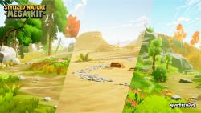
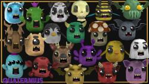
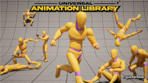
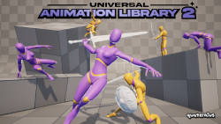

# OpenGameArt: Quaternius 3D art

**4 assets from [OpenGameArt](https://opengameart.org), dedicated to the public domain under [CC0](https://creativecommons.org/publicdomain/zero/1.0/).** Use them in any game, free or paid, and change them however you like; no credit is needed.

3D art from OpenGameArt entries licensed CC0 (some also offer other licences; CC0 is the one that applies here). 250.6 MB in all.

This is a copy kept by [zuujis-cc0](https://github.com/zuujis-cc0) so game makers can take single files from GitHub. It is not made by or affiliated with OpenGameArt: the originals, often in more formats and higher resolutions, are on [opengameart.org](https://opengameart.org). If they help you, consider [supporting OpenGameArt](https://opengameart.org/content/faq).

Every file is listed in [MANIFEST.tsv](MANIFEST.tsv) with its size and SHA-256. More free assets: [the Zuujis collection](https://github.com/zuujis-cc0/free-game-assets#readme).

| | | | |
| :-: | :-: | :-: | :-: |
|  <b><a href="stylized-nature-megakit">Stylized Nature MegaKit</a></b> by quaternius · <a href="https://opengameart.org/content/stylized-nature-megakit">source</a> |  <b><a href="textured-cute-monster-pack">Textured Cute Monster Pack</a></b> by quaternius · <a href="https://opengameart.org/content/textured-cute-monster-pack">source</a> |  <b><a href="universal-animation-library">Universal Animation Library</a></b> by quaternius · <a href="https://opengameart.org/content/universal-animation-library">source</a> |  <b><a href="universal-animation-library-2">Universal Animation Library 2</a></b> by quaternius · <a href="https://opengameart.org/content/universal-animation-library-2">source</a> |

---

Kept up to date by this repository's own [update workflow](.github/workflows/update.yml), with code and plan from [cc0-mirror](https://github.com/zuujis-cc0/cc0-mirror). Something wrong? [Open an issue there](https://github.com/zuujis-cc0/cc0-mirror/issues/new) or use the [private report form](https://games.zuujis.com/report).
